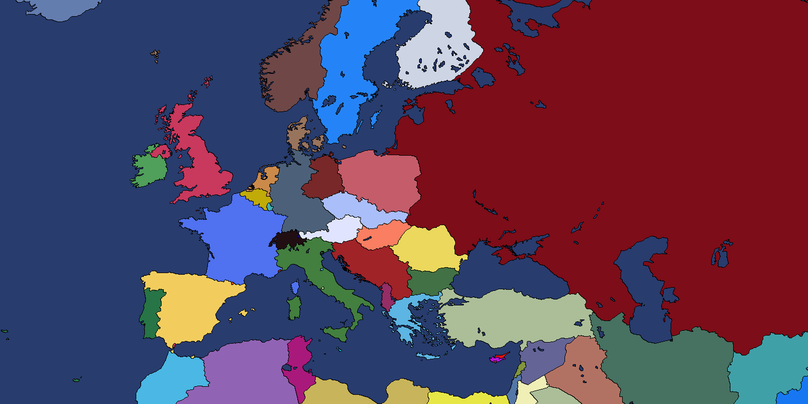

# Балканы 1980: распад Югославии (HOI4)

**Скачать мод:** [`Balkan_Collapse_1980_v3.zip`](Balkan_Collapse_1980_v3.zip). Распакуй архив и запусти `START_BALKAN.bat` (подробнее в `README_RU.txt` внутри архива).

Это самостоятельный мод. Millennium Dawn ставить не нужно: карта с реальными границами уже внутри.



## Версия 3.1 — распад Югославии строго по истории

| Закладка | Дата | Что происходит |
|---|---|---|
| **Распад Югославии — 1980** (по умолчанию) | 1 мая 1980 | Тито при смерти, СССР ещё цел, границы мира — как в 1980 году |
| **После Дейтона — 1995** | 14 декабря 1995 | Дейтон подписан: Босния разделена на два энтитета, Краина стёрта с карты, СРЮ под санкциями, СССР уже прекратил существование |
| **Сербия — 2026** | 1 января 2026 | Сегодняшние реальные границы, правители 2026 года, «Студенческий список» у власти в Белграде |

### Хронология сценария 1980 (55 событий, реальные даты)

Всё идёт по истории — от падения берлинской стены до заявки Сербии в ЕС:

| Дата | Событие |
|---|---|
| 4 мая 1980 | Смерть Тито, начало кризиса федерации |
| 27 июня 1981 | Протесты в Приштине, требование статуса республики для Косово |
| 28 июня 1989 | Речь на Газиместане — 600 лет Косовской битвы |
| 9 ноября 1989 | Падение Берлинской стены |
| апрель–декабрь 1990 | Первые свободные выборы: Словения, Хорватия, Босния, Македония, Сербия |
| 21 марта 1991 | Рачак: кровопролитие в Косово |
| 19 мая 1991 | Референдум в Хорватии |
| **25 июня 1991** | **Словения и Хорватия провозглашают независимость** |
| 27 июня – 7 июля 1991 | Десятидневная война и Брионская декларация |
| 1 июля 1991 | Плитвицкая полицейская война |
| **27 августа 1991** | **Самоуправление Сербской Краины (Книн)** — новое государство на карте |
| 12 октября 1991 | Провозглашение Республики Сербской Краины, война в Далмации |
| 25 октября 1991 | Признание Словении (день Святого Виктора) |
| 8 сентября / 25 сентября 1991 | Референдум и независимость Македонии — без единого выстрела |
| 9 января 1992 | Провозглашение Республики Сербской (Баня-Лука) |
| 29 февраля – 3 марта 1992 | Референдум и независимость Боснии и Герцеговины |
| **6 апреля 1992** | **Начало войны в Боснии** |
| 8 апреля 1992 | Провозглашение Хорватской Республики Герцеговина (Мостар) — третья сторона конфликта |
| 17 апреля 1992 | Признание БиГ и Хорватии большинством стран |
| 27 апреля 1992 | Образование СРЮ, санкции ООН |
| 17 мая 1992 | Референдум о выводе ЮНА — армия превращается в армию войны |
| 22 сентября 1992 | Босния и Герцеговина в ООН |
| 25 января 1993 | План Вэнса — Оуэна |
| 20 марта 1993 | Резолюция ООН 827, бесполётная зона |
| 25 мая 1993 | Международный уголовный трибунал по Югославии |
| 3 февраля 1994 | Вашингтонское соглашение, перемирие |
| 10 апреля 1995 | Пасхальный теракт в Сараево |
| 11 июля 1995 | Сребреница |
| 4–9 августа 1995 | Операция «Вспышка» и операция «Буря», падение Краины |
| 12 ноября 1995 | Эрдутское соглашение — Восточная Славония возвращается Хорватии |
| **14 декабря 1995** | **Дейтонские соглашения**: Босния разделена, Герцеговина входит в Федерацию БиГ |
| декабрь 1996 | Выборы в Сербии: правящая партия теряет власть |
| 15 марта 1998 | Начало Косовской войны, операция АОК в Преказе |
| февраль–март 1999 | Рамбулейские переговоры срываются |
| 24 марта 1999 | Бомбардировки НАТО, 78 дней |
| 10 июня 1999 | Резолюция ООН 1244, миротворцы КФОР |
| 5 октября 2000 | «Бульдозерная революция», падение режима |
| 4 февраля 2003 | Союзная Республика Сербия и Черногория |
| 21 мая / 3 июня 2006 | Референдум и независимость Черногории |
| 17 февраля 2008 | Косово провозглашает независимость |
| 22 июля 2009 | Решение Международного суда по Косово |
| 22 июля 2010 / 1 марта 2012 | Заявка в ЕС и статус кандидата |
| 25 октября 2026 | Победа «Студенческого списка» в Белграде |

### Что добавлено в 3.1

- **Гражданская война по истории.** Две войны с настоящими участниками: Словения против ЮНА (десять дней), Хорватия против ЮНА и Краины, Босния — три стороны: Республика Сербская, Хорватская Республика Герцеговина и сама БиГ. Дейтон, Эрдут и операция «Буря» закрывают конфликты, Краина исчезает с карты, Герцеговина входит в Федерацию БиГ.
- **Два новых государства** с собственными деревьями фокусов (по 21 фокусу), историческими правителями и флагами из арта Millennium Dawn: `RKS` — Республика Српска Краина (1991–1995, Далмация) и `HZG` — Хорватская Республика Герцеговина (1992–1995, Мостар).
- **Настоящие правители на момент независимости:** Милан Кучан и Франьо Туджман (1991), Киро Глигоров, Радован Караджич (1992), Алия Изебегович, Милан Бабич (Краина), Мате Бобан (Герцеговина), Милорад Додик (Республика Сербская, 2026).
- **Сценарий «После Дейтона» теперь начинается 14 декабря 1995 года** — в день подписания соглашения, а не в январе; там уже разделенная Босния, стёртая Краина и подсанкционная СРЮ.
- **Исправлены сценарии 1995 и 2026:** у Сербии выставлены флаги «Тито мёртв», «Распад начался» и «СРЮ образована» — иначе дерево фокусов было недоступно, и в игре нельзя было сделать вообще ничего.
- **Портреты правителей можно добавлять самому:** кидай файлы в `assets/extra_portraits/<ТЕГ>/<Фамилия>.dds` — сборка подставит их автоматически (см. `assets/extra_portraits/README.md`).

### Что было в 3.0

- Три сценария, распад СССР 26 декабря 1991 года — по истории: пятнадцать республик с правителями, флагами и идеями.
- Настоящие портреты правителей (арт Millennium Dawn, CC BY-SA 4.0).
- Своё дерево фокусов у каждой страны мира (395 деревьев, 4865 фокусов) — больше ни одна страна не остаётся без фокусов.
- Подходящие картинки у фокусов: иллюстрации из Millennium Dawn по темам (армия, дипломатия, экономика, идеология) — все иконки разрешаются, «пустых» иконок нет.
- Загрузочные экраны: 1) «Сербия 1980» — начало разрухи, 2) «Сербия», 3–5 — Белград. Фонов 1937/1939 больше нет (`replace_path="gfx/loadingscreens"`).
- Границы по реальности: в сценарии 2026 Крым и Донбас у Украины, Чечня у России, Абхазия и Южная Осетия у Грузии, Приднестровье у Молдовы.

### Что было в 2.0

- Старт 1 мая 1980 года. Мир в границах 1980 года: СССР, ГДР/ФРГ, Чехословакия, Югославия. Закладок 1936/1939 больше нет.
- Карта, провинции и стейты взяты из Millennium Dawn (из `милениум.part*.rar`), поэтому ID стейтов совпадают с Millennium.
- Деревья фокусов: СФРЮ/Сербия (56 фокусов, три пути восстановления Югославии), а также Хорватия, Словения, Босния и Герцеговина, Республика Сербская, Черногория, Косово и Северная Македония.

## Сборка из исходников

```
# 1. распаковать милениум.part1.rar (нужен unrar) и Millennium Dawn с GitHub
# 2. собрать мод
python3 tools/build_mod.py --md-archive <распакованный милениум.part1.rar> \
    --md-repo <sparse checkout MillenniumDawn/Millennium-Dawn> \
    --old-mod <распакованный Balkan_Collapse_1980 (9).zip> --out build/
python3 tools/validate_mod.py build/Balkan_Collapse
# 3. собрать релиз
python3 tools/package_mod.py --build build/Balkan_Collapse \
    --old-zip Balkan_Collapse_1980_v2.zip --out Balkan_Collapse_1980_v3.zip
```

Файлы мода:

- `tools/build_mod.py` — карта, стейты, страны, флаги, локализация, портреты правителей.
- `tools/balkan_content.py` — Югославия: фокусы, события (1980–2026), идеи, закладка 1980.
- `tools/world_content.py` — три сценария, распад СССР, портреты, деревья фокусов для всех стран.
- `tools/validate_mod.py` — статические проверки (0 ошибок, 0 предупреждений).
- `tools/package_mod.py` — сборка релизного архива.
- `assets/extra_portraits/` — свои портреты правителей (подхватываются автоматически).

Карта, портреты, флаги и иллюстрации фокусов © Millennium Dawn team, лицензия CC BY-SA 4.0.
